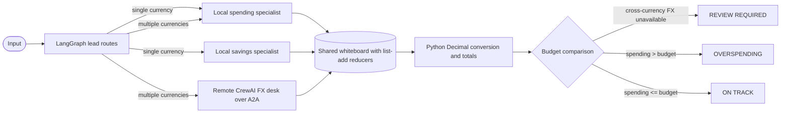

# Personal Finance Check

A LangGraph budget manager calls local `spending` and `savings` specialists, and calls a separate CrewAI `fx` desk over A2A when it sees multiple currencies. The specialists provide observations; `Decimal` arithmetic in Python converts and totals expenses, compares spending to the budget, and decides `ON TRACK` or `OVERSPENDING`. A failed FX call on a cross-currency input produces `REVIEW REQUIRED`.

The rates are fixed exercise assumptions in `finance_math.py`: `1 USD = 1.00 USD`, `1 EUR = 1.10 USD`, and `1 CAD = 0.75 USD`. They are deliberately illustrative, not live exchange rates. The FX desk repeats that limitation; verify actual rates and fees before using real financial data. This project is a programming exercise, not financial advice.

## Run

Use the Python 3.12 or 3.13 environment configured for Module 7, with its dependencies installed and `OPENROUTER_API_KEY` in the repository-root `.env`. Keep the key out of this folder and the submission zip.

Terminal 1, from this folder:

```sh
python remote_desk.py
```

Terminal 2, also from this folder:

```sh
python manager.py match
python manager.py stretch
```

`match` routes to `spending` + `savings` and expects `ON TRACK`. `stretch` routes to `fx` + `spending` and expects `OVERSPENDING`. The lead requests a team, then code filters the request to allowed names, enforces the two-specialist budget, and ensures the required coverage. The graph has a `recursion_limit` of 10.

Run the deterministic arithmetic checks without an API key:

```sh
python -m unittest test_finance_math.py -v
```

Print the Mermaid graph:

```sh
python manager.py --draw
```

## Diagram



## Evidence capture

Save actual output from both terminals. Do not handwrite or estimate transcripts or cost cards.

1. In Terminal 1, start the desk while capturing its log: `python remote_desk.py 2>&1 | tee evidence/desk_log.txt`.
2. In Terminal 2, save the two manager runs: `python manager.py match 2>&1 | tee evidence/run1.txt`, then `python manager.py stretch 2>&1 | tee evidence/run2.txt`.
3. Save the actual advertised card: `curl -fsS http://127.0.0.1:9999/.well-known/agent-card.json -o evidence/card.json`.
4. Stop Terminal 1 with Ctrl+C. Run `python manager.py stretch 2>&1 | tee evidence/fail_closed.txt`; it should report `REVIEW REQUIRED` because the FX call cannot be made. Restart the desk after the test if needed.
5. Keep the manager cost cards in `run1.txt` and `run2.txt`; keep the remote FX model usage and cost in `desk_log.txt`.

## Would one agent have been enough?

For the arithmetic and final decision, one deterministic Python calculation would have been enough; the agent network added explanations and exercised A2A, not numeric correctness. The two successful manager runs used 7 calls and 2,089 tokens for `$0.00043`; the separate FX desk added 1 call and 406 tokens for `$0.00007`. Together that is 8 calls, 2,495 tokens, and `$0.00050`. The manager reported 5.4 seconds for `match` and 6.0 seconds for `stretch`; the FX desk reported 2.4 seconds during the second run. The specialists added spending-category and savings observations, and the FX desk clearly stated the rates were illustrative. With the FX desk stopped, the mixed-currency case returned `REVIEW REQUIRED` rather than presenting its fixed-rate total as safe to rely on.

## Submit

Before zipping, make sure `evidence/` contains `run1.txt`, `run2.txt`, `fail_closed.txt`, `card.json`, and `desk_log.txt`. Exclude `.env`. Attach the zip to a new Students-repo issue using **M7 Mini-Project — The Agent Network**. Include the completed one-agent paragraph.